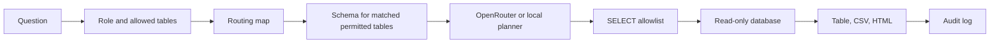

# Fieldnote

Fieldnote answers business questions with read-only SQL. You ask in English or Cantonese. A routing map picks the table, your role decides whether you can use it, and the app runs a single `SELECT` against the demo warehouse.

The demo ships with SQLite tables for revenue and daily active users, so it runs without Athena or a language-model key. Set `OPENROUTER_API_KEY` when you want an OpenRouter-compatible model to write the SQL.

## Run it

```bash
python -m venv .venv
source .venv/bin/activate
pip install -r requirements.txt
python -m streamlit run app.py
```

Open [http://localhost:47221](http://localhost:47221).

Copy `.env.example` to `.env` only if you want to override the defaults. The sample database is created at `data/demo.db` on first launch. Rebuild it with:

```bash
python -m src.db.seed
```

## Sign in

`config/users.yaml` is a stand-in for SSO. `src/auth.py` is the function to replace with the company identity provider. Everyone else in the app only sees a username, a role, and the tables that role may use.

| Username | Password | Role | Tables |
| --- | --- | --- | --- |
| analyst | analyst | analyst | revenue, dau |
| finance | finance | finance | revenue |
| growth | growth | growth | dau |

## Try these

- `What was total revenue by product over the last 90 days?` uses the revenue table.
- `Show daily active users by platform for the last 30 days` uses the DAU table.
- `過去 90 日各產品收入` and `最近 30 日各平台日活` use the same map.
- `What's the weather in Hong Kong?` asks you to pick a topic the role can access.
- A finance account that asks about DAU is stopped before any DAU columns are queried.
- After a result, use **Download CSV** or **Download HTML**. The file contains that result only.

With no API key, a local planner writes the SQL and the screen says so. With a key, the model writes it. Either way the query has to pass the SELECT allowlist before it runs.

## Environment

| Variable | Purpose |
| --- | --- |
| `OPENROUTER_API_KEY` | Bearer token for OpenRouter or another OpenAI-compatible API. Leave empty to use the local planner. |
| `OPENROUTER_MODEL` | Model id. Default `openai/gpt-4o-mini`. |
| `OPENROUTER_BASE_URL` | Chat completions base URL. Default `https://openrouter.ai/api/v1`. |
| `DB_BACKEND` | `sqlite` (default), `postgres`, or `athena`. Only SQLite is implemented. |
| `DB_PATH` | Demo database path. Default `data/demo.db`. |
| `DATABASE_URL`, `DB_USER`, `DB_PASSWORD` | Read-only Postgres credentials for a future adapter. Unused by SQLite. |
| `ATHENA_REGION`, `ATHENA_DATABASE`, `ATHENA_WORKGROUP`, `ATHENA_OUTPUT` | Future Athena adapter. Unused by SQLite. |
| `AUDIT_PATH` | Usage log. Default `data/audit.db`. |
| `MAX_RESULT_ROWS` | Cap on fetched rows. Default 500. |

The API key and database password are read from the environment inside the server process. They are not written into the prompt, the page, or the export.

## Routing map

Edit `config/routing.yaml`. Each topic has a title, the tables it may use, and synonyms. English phrases match on word boundaries. Synonyms with non-ASCII characters match as substrings, which covers the Cantonese entries.

Save the file and ask again. The next question picks up the change. To expose a new table later:

1. Add the table to the database.
2. Add a topic that points at it, plus a description under `tables:`.
3. Add the table name to a role in `config/users.yaml`.

Questions that match nothing get a clarifying reply that lists only the topics that role can access. Questions that match two topics ask you to pick one, because revenue and DAU do not share a grain.

## How a question moves



The allowlist parses the statement and keeps a single `SELECT` or `WITH ... SELECT`. Inserts, updates, deletes, DDL, pragmas, attached databases, and file functions are rejected. Physical tables have to be inside the caller's allowlist, including tables hidden behind a CTE. SQLite is opened with `mode=ro` and `PRAGMA query_only`, so a write still fails if a statement gets past the parser.

Results wider than the preview are truncated on screen. CSV and HTML download the fetched rows and only the columns in that result.

Each question is appended to the audit database with the user, role, tables, SQL, status, and row count.

## Swap in Postgres or Athena

`src/db/sqlite.py` is the running adapter. `src/db/postgres.py` and `src/db/athena.py` are the seams: implement `get_schema`, `row_count`, and `execute_select` with a read-only role, then set `DB_BACKEND`. The prompt dialect and the SQL parser follow the adapter (`sqlite`, `postgres`, or `presto`). Keep the guard in front of `execute_select`. Do not put the connection string or password in the prompt.

## Tests

```bash
pytest
```

The tests cover routing, the role map, the SELECT allowlist, blocked writes, CSV/HTML export, and the revenue, DAU, unknown-topic, and permission paths.
